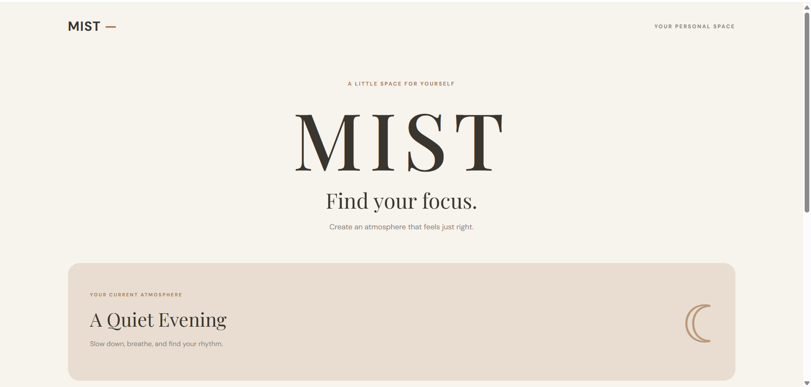
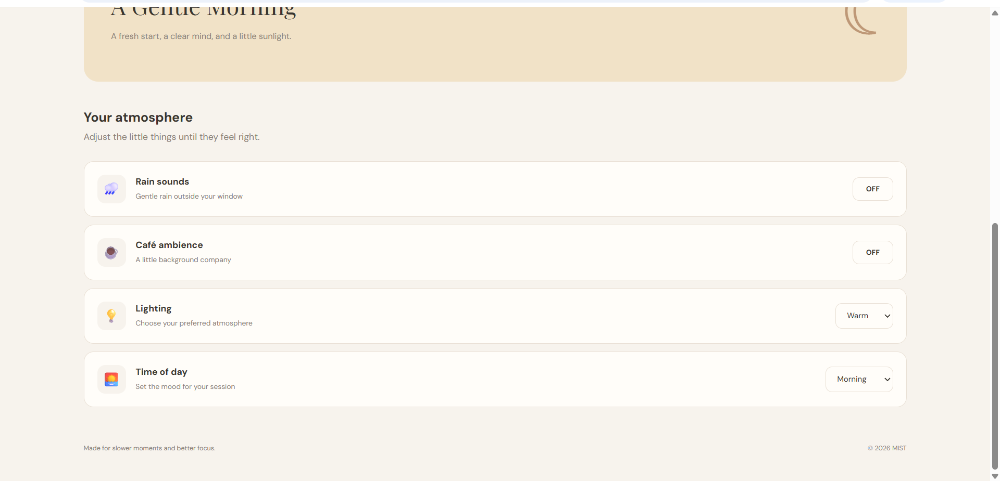
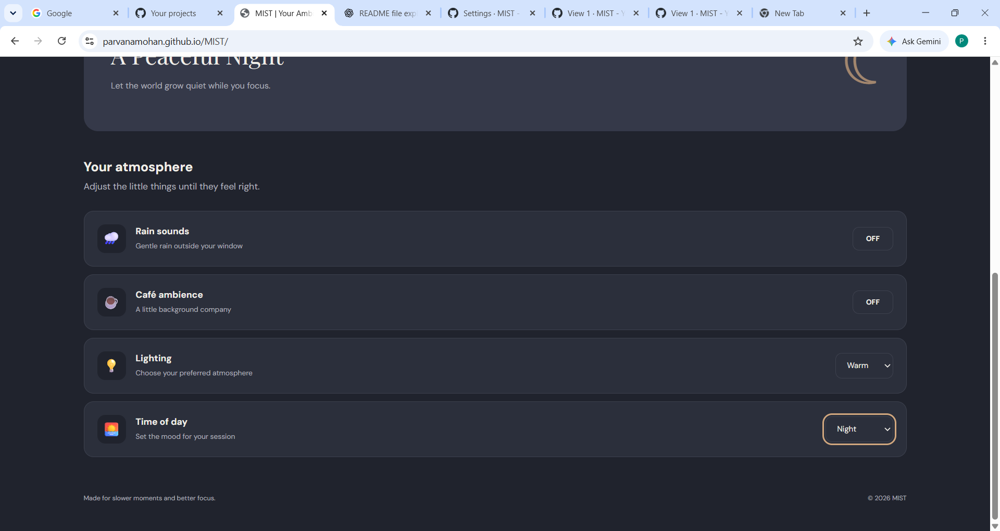
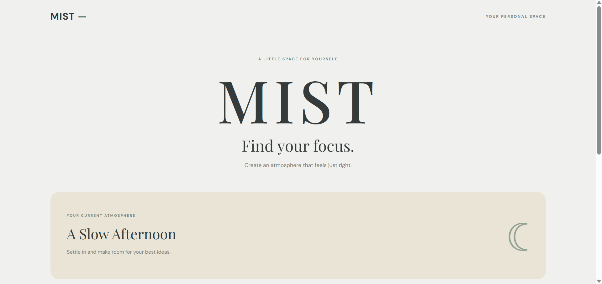
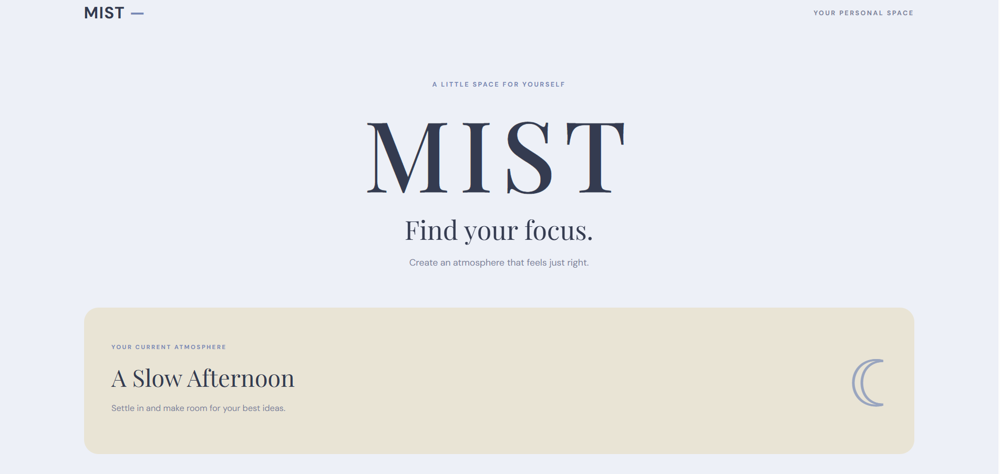

# MIST – Your Ambient Workspace 🌙

**Your site is live at:**  
https://parvanamohan.github.io/MIST/

## 📌 About the Project

MIST is a simple ambient workspace website designed to create a peaceful and comfortable environment for studying, working, or relaxing.

It allows users to customize their surroundings by choosing background sounds, lighting, and the time of day. The main aim of this project is to help users create an atmosphere that supports focus and relaxation.

## ✨ Features

- **Rain Sounds:** Play gentle rain sounds in the background.
- **Café Ambience:** Play café background sounds.
- **Lighting Options:** Choose different lighting settings.
- **Time of Day:** Select morning, afternoon, evening, or night.
- **Simple Interface:** Easy-to-use controls and a clean design.
- **Responsive Design:** Designed to provide a comfortable viewing experience across different screen sizes.

## 🛠️ Technologies Used

- **HTML5:** Used to create the structure of the website.
- **CSS3:** Used for styling, layout, and visual appearance.
- **JavaScript:** Used to add interactive features and control the website's settings.


## Project Structure

```text
MIST/
├── assets/
│   ├── rain.mp3
│   └── cafe.mp3
├── index.html
├── rain.html
├── style.css
├── script.js
└── README.md
```


## 🚀 How to Use

1. Open the MIST website using the link provided above.
2. Use the Rain Sounds button to turn rain audio on or off.
3. Use the Café Ambience button to control café sounds.
4. Select your preferred lighting.
5. Choose a time of day to customize your atmosphere.
6. Enjoy your personalized workspace.

## Screenshots







## 🎯 Purpose of the Project

The purpose of MIST is to provide users with a simple digital space where they can create a comfortable atmosphere for studying, working, or relaxing.

It is a beginner-level web development project created to practice HTML, CSS, and JavaScript while exploring interactive website design.

## 🔮 Future Enhancements

- Add more background sound options.
- Provide more customization options.
- Add a timer for study sessions.
- Include additional themes and atmosphere settings.

## 👩‍💻 Author

**Parvana Mohan**

---

*Made for slower moments and better focus.*
